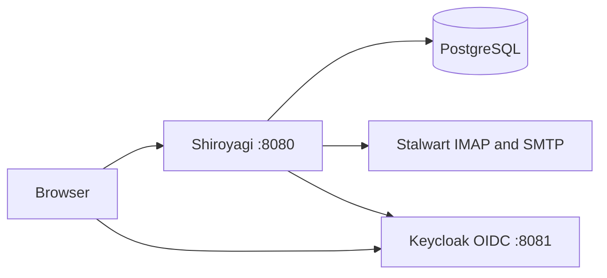

# Shiroyagi

Self-hosted webmail for on-premise mail servers.

## Start development

Create dev secret files first:

```bash
mkdir -p secrets/dev
printf 'shiroyagi' > secrets/dev/postgres_password
openssl rand 32 > secrets/dev/mail_account_kek
printf 'dev-oidc-client-secret' > secrets/dev/oidc_client_secret
```

Windows users can run these commands from WSL.

### Run the complete development environment

Run all development services, including the Go application, in containers:

```bash
podman compose -f compose.yaml -f compose.dev.yaml up
```

### Run the Go application locally

Start the complete development environment in the background:

```bash
podman compose -f compose.yaml -f compose.dev.yaml up -d
```

Stop the containerized Go application:

```bash
podman compose -f compose.yaml -f compose.dev.yaml stop web
```

Then run the Go application on the host.

**macOS and Linux**

```bash
./scripts/run-dev.sh
```

**Windows PowerShell**

```powershell
.\scripts\run-dev.ps1
```

> [!NOTE]
> `MAIL_ACCOUNT_KEK_VERSION` selects the KEK version used to encrypt newly saved mail account secrets. Development uses version `1`.
>
> Keycloak automatically imports the development realm on startup. The `dev` realm, `shiroyagi` OIDC client, and `dev` user are defined in `dev/keycloak/realm.json`.
>
> In compose, Shiroyagi uses `OIDC_ISSUER=http://keycloak.localhost:8081/realms/dev` for discovery, browser redirects, token exchange, and ID token issuer verification. The `keycloak.localhost` name is shared between the browser and the compose network. The app retries OIDC discovery while Keycloak is still starting.
>
> The development app login is `dev` / `dev`. The Keycloak admin console login is `admin` / `admin`.

## Development layout



URLs:

- Web: http://localhost:8080
- Keycloak: http://keycloak.localhost:8081

Login check:

```text
http://localhost:8080/signin
```

### Development mail

When upgrading an existing development stack from Dovecot and Mailpit, run
`podman compose -f compose.yaml -f compose.dev.yaml down --remove-orphans`
before starting it again. This frees the old mail ports and keeps the volumes.

Stalwart creates the `example.test` domain and test accounts on first start.
It adds the messages in `dev/stalwart/fixtures` to the `dev@example.test`
inbox, checking their Message-IDs so restarting does not add duplicates. The
`stalwart_data` volume retains the accounts and messages. Stalwart accepts
delivery to its local test mailboxes and rejects external recipients.

Sign in to Shiroyagi and create a mail account for `dev@example.test` under
`Mail accounts`. Use the email address as the IMAP and SMTP username and
`shiroyagi-dev` for both passwords. Update saved development mail accounts
with the following settings.

| Shiroyagi runs in | IMAP host and port | IMAP protocol | SMTP host and port | SMTP protocol |
| --- | --- | --- | --- | --- |
| Compose | `stalwart:31143` | `IMAP` | `stalwart:1025` | `Plain` |
| Host | `localhost:2143` | `IMAP` | `localhost:1025` | `Plain` |

The host ports bind to IPv4 loopback. The development Compose environment
allows authentication on its non-TLS IMAP and SMTP connections.

The other test mailboxes are `alice`, `bob`, `carol`, `notifications` and
`ops` at `example.test`. They use the same development password. Add a second
mail account in Shiroyagi with the recipient's address and IMAP settings to
check delivery. To inspect raw headers or MIME structure, open the recipient
mailbox with an IMAP client such as Thunderbird and view the message source.

If you change the fixtures, rebuild the Stalwart image with
`podman compose -f compose.yaml -f compose.dev.yaml up -d --build stalwart`.
To add a new fixture to an existing inbox, give it a unique Message-ID.

#### IMAP check

1. Open `Inbox` for `dev@example.test` from the mail account list.
2. Confirm that the fixture messages are listed and that opening one displays
   its inline text body.

The inbox shows up to the latest 100 messages.

#### SMTP check

1. Open `Send` for `dev@example.test`.
2. Send a message to `alice@example.test`.
3. Open Alice's inbox and confirm that the subject and body match.

#### Reply check

1. Open `Welcome to Shiroyagi` in the dev inbox and click `Reply`.
2. Confirm that `To` is prefilled from `Reply-To` or `From` and that the subject
   is prefixed with `Re:`.
3. Send the reply. Confirm in Alice's received message that `In-Reply-To` and
   `References` contain the original Message-ID.
4. Confirm that the original message appears as `Replied` in the dev inbox,
   reflecting its IMAP `\Answered` flag.

#### Reply all check

1. Open `Reply all fixture` in the dev inbox and check that the original
   `To` and `Cc` headers are visible.
2. Click `Reply all`. Confirm that `To` is `alice@example.test` and `Cc` is
   `bob@example.test, carol@example.test`.
3. Send the reply and verify delivery in all three recipients' inboxes.

#### Forward check

1. Open `Forward fixture` in the dev inbox and click `Forward`.
2. Confirm that the subject is prefixed with `Fwd:` and that the body shows the
   original message headers and text.
3. Forward the message to `alice@example.test` and check Alice's inbox.
4. Confirm that the original message appears as `Forwarded` in the dev inbox,
   reflecting its IMAP `$Forwarded` keyword.

If SMTP sending succeeds but a reply or forward flag update fails, the
message remains sent and the result page shows a warning.

#### Attachment check

1. Open `Attachment fixture` in the dev inbox. Confirm the original attachment
   name is shown as `../original-report.txt`.
2. Download it and confirm that the browser offers `original-report.txt` and
   that the file contains `This is the attachment fixture.`
3. Open `Send`, attach a file and send it to `alice@example.test`. Confirm in
   Alice's received message that it is attached as part of `multipart/mixed`.
4. Reply to the attachment fixture and confirm that only files selected in
   the reply form are attached.
5. Forward the attachment fixture and confirm that the original attachment
   and any additional files selected in the forward form are included.

Shiroyagi treats attachments as opaque bytes: it does not preview, execute, or
extract them. Uploads allow at most 10 files and 25 MiB total. Received messages
are limited to 50 MiB, individual decoded attachments to 25 MiB, MIME nesting
to 10 levels, and MIME part count to 100. Downloads always use attachment
disposition, disable content sniffing, and use a sanitized filename; the
original filename remains visible on the message page.

## Build

```bash
make build
```

This creates the `shiroyagi` binary and writes Go module, dependency, build setting, and VCS metadata to `shiroyagi-build-info.txt`.

The binary version defaults to `git describe --tags --always --dirty`.

```bash
./shiroyagi --version
```

## Release build

To create a release archive for the current operating system and architecture:

```bash
make release
```

To build an archive for a specific target platform, set `GOOS` and `GOARCH`:

```bash
make release GOOS=linux GOARCH=amd64
```

Generated archives and their SHA-256 checksums are written to `dist/`:

```text
dist/
├── shiroyagi_v0.1.0_linux_amd64.tar.gz
└── checksums.txt
```

Release binaries are built with `CGO_ENABLED=0` to avoid runtime dependencies on the target system’s C library, such as `glibc`.
